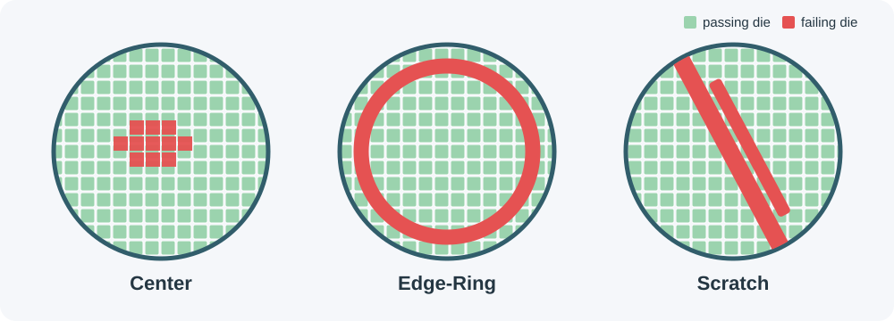

# Wafer Map Failure Pattern Classification

This repository contains the group project developed for the **Foundations of Deep Learning** university course at the University of Milano-Bicocca, academic year 2025/2026.

## From a silicon wafer to a wafer map

During semiconductor fabrication, hundreds of integrated circuit units (**dies**) are manufactured simultaneously on a circular silicon slice called a **wafer**. After production, electrical testing classifies each die as either functional or failing.

A **wafer map** is the resulting 2D spatial grid representing these test outcomes across the wafer surface. Rather than an ordinary natural image, it is a topological map whose failure geometry (such as rings along the edge, center clusters, or scratches) reflects specific equipment faults and fabrication issues. Automatically classifying these spatial patterns supports faster root-cause analysis and quality control.



*Schematic wafer map representations: passing dies (green), failing dies (red), and exterior background.*

## The problem

Given a wafer map, the project aims to train and evaluate a deep learning model that assigns it to one of the known failure-pattern categories in **MIR WM-811K**:

- `Center`
- `Donut`
- `Edge-Loc`
- `Edge-Ring`
- `Loc`
- `Near-full`
- `Random`
- `Scratch`
- `none` (no recognized failure pattern)

These are the literal label strings used by the dataset and by the canonical class encoding in [`src/fdl_project/constants.py`](src/fdl_project/constants.py); alternative spellings and orderings are rejected rather than normalized.

This is a multiclass image-classification problem, but it presents several challenges beyond a conventional benchmark:

- wafer maps have varying spatial dimensions and die layouts;
- only part of the complete collection has expert-assigned labels;
- the labeled classes are highly imbalanced;
- the `none` class dominates, while some failure patterns are rare;
- resizing or padding must preserve meaningful spatial structures;
- accuracy alone can hide weak performance on minority failure classes.

The work will therefore include dataset exploration, a reproducible preprocessing pipeline, model development, controlled experiments, and both quantitative and qualitative error analysis. Evaluation should emphasize the confusion matrix, per-class precision, recall and F1-score, and macro-averaged F1 in addition to overall accuracy.

## Dataset

The project uses the **MIR WM-811K** dataset, a real-world collection of **811,457 wafer maps** from semiconductor fabrication. Approximately **172,950 maps have an assigned label**, while the remaining maps are unlabeled. The labeled portion contains the eight recognized defect patterns plus the `None` category and is strongly imbalanced.

- **Official download:** [MIR-WM811K.zip](http://mirlab.org/dataSet/public/MIR-WM811K.zip)
- **Input:** two-dimensional wafer maps
- **Task:** failure-pattern classification
- **Full collection:** 811,457 maps
- **Labeled subset:** approximately 172,950 maps

The dataset archive is intentionally not committed to Git. Downloaded data, generated artifacts, and trained weights should be stored locally in their designated directories and managed according to the repository's version-control policy.

---

## Workflow & Experimental Methodology

The goal of this project was to understand how modern deep learning approaches handle spatial structures under extreme class imbalance and domain constraints. Rather than jumping directly into complex black-box architectures, we designed a structured, hypothesis-driven workflow:

### 1. Handling Class Imbalance & Lot Leakage
- **Lot-Stratified Data Split**: In semiconductor manufacturing, wafers are processed in batches called **lots** (`lotName`). Wafers within the same lot share similar tool conditions and failure modes. Splitting wafers purely at random would cause massive data leakage between train and test. In [`notebooks/preparation/split_data.ipynb`](notebooks/preparation/split_data.ipynb) (documented in [`docs/reports/split_strategy.md`](docs/reports/split_strategy.md)), we developed a lot-aware partitioning algorithm keeping every lot strictly within one split, achieving an exact 70% Train, 20% Validation, and 10% Test allocation where all 9 classes maintain their relative proportions.
- **Imbalance Mitigation**: With `none` representing over 85% of wafers and `Near-full` accounting for only 104 training examples (a 992:1 ratio), we evaluated multiple imbalance techniques in [`notebooks/preparation/class_imbalance_analysis.ipynb`](notebooks/preparation/class_imbalance_analysis.ipynb). The best-performing approach was **inverse-square-root weighted sampling** ($w_c \propto 1 / \sqrt{N_c}$), which moderates majority dominance without discarding data, while validation and test sets remained unweighted to preserve their natural real-world distribution.

### 2. Preprocessing & The Role of the Baseline CNN
- **Categorical Image Preprocessing**: Wafer maps have diverse spatial dimensions (from $10 \times 10$ to $212 \times 212$) and discrete die status values (`0`: background, `1`: normal die, `2`: defective die). We compared continuous interpolation vs discrete transformations in [`notebooks/preparation/preprocessing_comparison.ipynb`](notebooks/preparation/preprocessing_comparison.ipynb), establishing a deterministic pipeline using **aspect-ratio preserving letterbox resizing** and **one-hot categorical encoding** (producing a 3-channel binary tensor of shape `(3, H, W)`).
- **Baseline CNN as a Controlled Testbed**: We implemented a lightweight **`BaselineCNN`** (~157k parameters) in [`src/fdl_project/models/baseline_cnn.py`](src/fdl_project/models/baseline_cnn.py). Because it was fast and reproducible, it served as the baseline to isolate and validate core pipeline choices:
  - Validating the superiority of one-hot binary encoding over grayscale conversion.
  - Comparing loss formulations (Cross-Entropy vs Focal Loss).
  - Screening augmentation policies before scaling to larger models.

### 3. Data Augmentation & Spatial Inductive Biases
- **Rotational Invariance**: Silicon wafers are circular, meaning defects have no privileged orientation. Introducing **continuous free-angle rotation** ($\theta \in [0, 360^\circ]$) in [`src/fdl_project/data/augmentation.py`](src/fdl_project/data/augmentation.py) proved to be the single most impactful factor in the entire project, boosting Macro-F1 on the baseline CNN from **0.817 to 0.880** and doubling the recall of delicate linear patterns like `Scratch` (F1 jumped from 0.376 to 0.732).
- **Dilated Convolutions**: Thin scratches and boundary rings span across the entire wafer surface. We introduced a **`DilatedCNN`** using stacked atrous convolutions ($r \in \{1, 2, 4, 8\}$) without spatial downsampling. Dilation markedly improved receptive field coverage for the CNN (+0.0636 Macro-F1), though on architectures that already downsample (like ConvNeXt), dilation yielded diminishing returns.

### 4. Model Architectures & Experimental Grid
We explored a wide spectrum of neural architectures to evaluate how different inductive biases behave on wafer maps:
- **Models Built From Scratch (Custom Implementations)**:
  - **`WaferResNet`**: Residual networks with identity shortcut connections to prevent vanishing gradients.
  - **`ConvNeXt-Style`**: Modernized pure convolutional architecture using $7 \times 7$ depthwise convolutions and inverted bottlenecks.
  - **`DilatedCNN`**: Multi-scale receptive field network maintaining full $64 \times 64$ spatial resolution without pooling.
  - **`DenseNet-Style` & `Inception-Style`**: Feature reuse and multi-scale kernel blocks.
  - **`ViT-Style`**: A pure Vision Transformer built from scratch to test self-attention directly on wafer patches.
- **Pre-trained Backbones & Transfer Learning**:
  - We adapted standard models pre-trained on [ImageNet-1k](https://www.image-net.org/) from [Torchvision](https://pytorch.org/vision/stable/models.html) (**ResNet-18**, **ResNet-34**, **ConvNeXt-Tiny**, **EfficientNet-B0**, and **ViT-B/32**).
  - We systematically tested **two transfer learning regimes**:
    1. *Frozen Backbone*: Keeping the feature extractor fixed and training only the MLP classifier head (which performed poorly, ~0.73 Macro-F1).
    2. *End-to-End Fine-Tuning*: Training with discriminative learning rates (encoder at $10^{-5}$, head at $10^{-3}$), which unlocked the full potential of pre-trained weights (~0.904 Macro-F1).
- **Ablation Parameters**: Across 36+ tracked runs, we systematically varied input resolution ($64 \times 64$ vs $128 \times 128$ vs $224 \times 224$), model parameter capacity, loss functions, learning rates, and augmentation strategies (documented in [`docs/experiment-grid.md`](docs/experiment-grid.md)).

### 5. Experiment Tracking & Google Colab Acceleration
- **Experiment Tracking with Weights & Biases**: All training runs, learning curves, GPU metrics, and per-class validation F1-scores were logged live using **[Weights & Biases (W&B)](https://wandb.ai/vlad-yelisieiev-bicocca-milano-bicocca/wm811k-wafer-defects)**. The dashboard allowed us to objectively compare convergence rates and spot overfitting early.
- **Google Colab Cloud Execution**: While development, modular packaging, and test suites were maintained locally, resource-intensive training sweeps and transformer fine-tuning were run on [Google Colab](https://colab.research.google.com/) using interactive driver notebooks in [`notebooks/experiments/`](notebooks/experiments/) to take advantage of cloud GPUs.

### 6. Results, Post-Hoc Calibration & Explainability (Grad-CAM)
- **Top Performing Models**:
  - Fine-tuned **ResNet-34** (21.4M params) and **ViT-B/32** (87.7M params) achieved top validation Macro-F1 scores (**0.9041** and **0.9029**).
  - Remarkably, our custom **`DilatedCNN`** (298k params) and **`ConvNeXt`** (414k params) built from scratch closely matched these massive models, reaching **0.8995** and **0.8988** Macro-F1. This confirmed that the quality of domain-specific spatial representation matters far more than raw model parameter size.
- **Post-Hoc Improvements (TTA & Score Weighting)**: Using [`scripts/posthoc.py`](scripts/posthoc.py) and [`src/fdl_project/evaluation/postprocessing.py`](src/fdl_project/evaluation/postprocessing.py), we squeezed further performance without retraining:
  - *Test-Time Augmentation (TTA)*: Averaged softmax probabilities across the 8 dihedral transformations ($D_4$), eliminating orientation bias.
  - *Class Score Weighting*: Per-class multipliers were tuned exclusively on the validation set via coordinate ascent to correct for remaining majority-class bias, then evaluated once on the frozen test set.
- **Explainable AI with Grad-CAM**: In [`scripts/gradcam.py`](scripts/gradcam.py) and [`notebooks/posthoc/posthoc.ipynb`](notebooks/posthoc/posthoc.ipynb), we implemented Grad-CAM across best-performing models to verify that predictions rely on genuine failure shapes:
  - Confirmed that models focus on circular outer rings for `Edge-Ring`, concentrated interior cores for `Center`/`Donut`, and continuous diagonal trajectories for `Scratch`, ruling out spurious background die correlations.

---

## Quickstart & Reproduction

### 1. Environment Setup

Ensure [`uv`](https://docs.astral.sh/uv/) is installed, then set up the virtual environment:

```bash
git clone https://github.com/ezero3/fdl-project.git
cd fdl-project
uv sync
```

Place the dataset file `WM811K.pkl` at `data/MIR-WM811K/WM811K.pkl`.

### 2. Running Training

Train a model using its declarative YAML configuration (or override CLI options):

```bash
uv run python scripts/train.py --config configs/train/defaults.yaml \
    --override model.name=dilated_style data.resolution=64
```

### 3. Evaluating Checkpoints & Post-Hoc Scoring

Batch score models on validation/test with TTA and threshold tuning:

```bash
uv run python scripts/posthoc.py \
    --checkpoint trained-models/checkpoints/best.pt \
    --split validation --tta --tune-thresholds
```

### 4. Generating Grad-CAM Visualizations

Generate spatial saliency heatmaps for defect classes:

```bash
uv run python scripts/gradcam.py \
    --checkpoint trained-models/checkpoints/best.pt \
    --classes Center Scratch Edge-Ring Donut \
    --output output/gradcam
```

---

## Technical Documentation & In-Depth Reports

For readers and reviewers interested in delving deeper into the engineering decisions, hardware benchmarks, and statistical evaluations, detailed technical reports are available under [`docs/`](docs/):

- [`docs/design-notes.md`](docs/design-notes.md): In-depth engineering rationale covering categorical vs. intensity mappings, downscaling analysis, and architectural choices.
- [`docs/experiment-grid.md`](docs/experiment-grid.md): Comprehensive benchmark table covering all **36 recorded runs** with 95% bootstrap confidence intervals and per-class metrics.
- [`docs/training-plan.md`](docs/training-plan.md): The phased experimental methodology (from baseline screening to architecture selection).
- [`docs/phase0-results.md`](docs/phase0-results.md): Hardware profiling and GPU memory benchmarks on NVIDIA T4 (Google Colab).
- [`docs/ROADMAP.md`](docs/ROADMAP.md): Project development backlog, team coordination, and priority milestones.
- Specialized topic reports:
  - [`docs/reports/eda_report.md`](docs/reports/eda_report.md): Exploratory data analysis and defect topological characteristics.
  - [`docs/reports/split_strategy.md`](docs/reports/split_strategy.md): Detailed lot-stratified group split formulation.
  - [`docs/reports/preprocessing_report.md`](docs/reports/preprocessing_report.md): Aspect ratio preservation and discrete state encoding benchmark.
  - [`docs/reports/class_imbalance_report.md`](docs/reports/class_imbalance_report.md): Full comparison of imbalance mitigation strategies.
